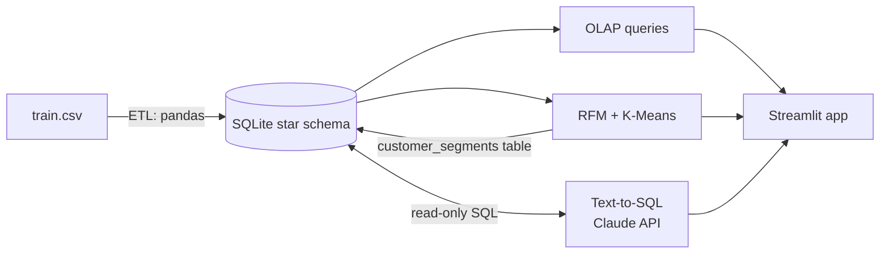
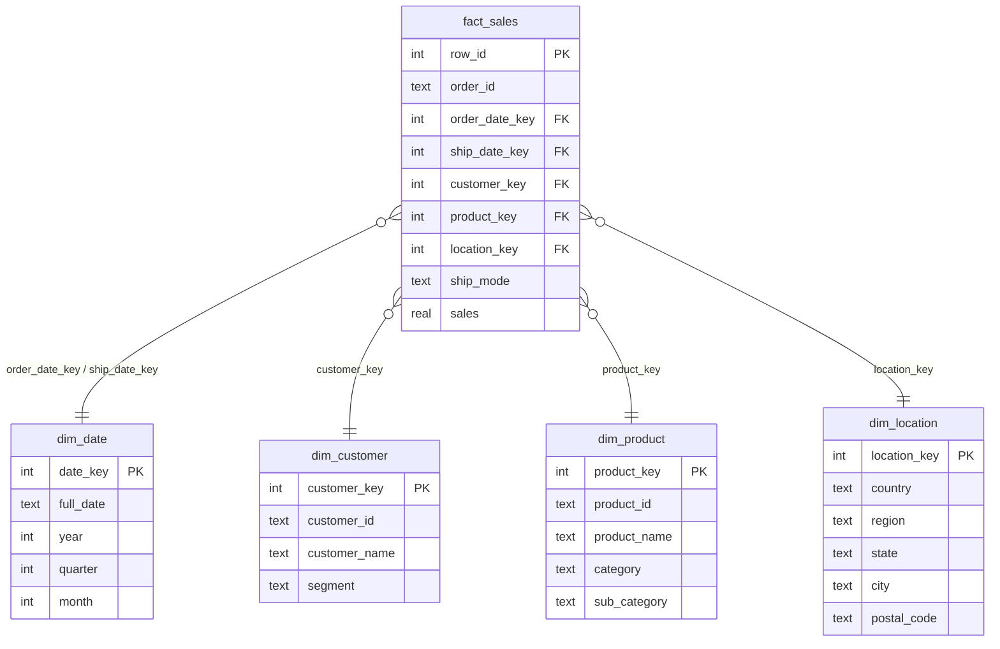

# GenAI-Ready Enterprise Data Warehouse for Intelligent Business Analytics and Decision Support

CSN447 Data Mining and Data Warehousing, Group 8
Saloni Rayal (1000019830), Gayatri Semwal (1000019886), Chhavi Tomar (1000020315)

## What this project does

A small enterprise data warehouse built on the Superstore sales dataset (9,800 order lines, 2015-2018),
with three things on top of it:

1. **OLAP**: roll-up, drill-down, slice, dice and pivot on a star schema.
2. **Data mining**: customer segmentation with RFM + K-Means.
3. **GenAI**: ask questions in plain English; Claude writes the SQL, the warehouse runs it, and Claude
   explains the result (text-to-SQL).

## Architecture



## Star schema



## Folder structure

```
data/train.csv               raw dataset
config.py, db.py             paths and read-only database helper
warehouse/                   ETL + star schema                          (Saloni)
olap_mining/                 OLAP queries + RFM/K-Means                 (Gayatri)
genai/                       text-to-SQL, safety checks, backup queries (Chhavi)
app.py                       Streamlit app (joins everything)
run_pipeline.py              rebuilds the warehouse and segments
tests/test_genai.py          tests for the GenAI layer (no API key needed)
```

## How to run (Windows)

```
python -m venv venv
venv\Scripts\activate
pip install -r requirements.txt

python run_pipeline.py          # builds warehouse/superstore_dw.db (takes a few seconds)
streamlit run app.py            # opens the app in the browser
```

To turn on the GenAI layer: copy `.env.example` to `.env` and paste an Anthropic key (`sk-ant-...`),
a Groq key (`gsk_...`), or both. Check with `python -m genai.test_api`. Without any key the Ask AI tab
still works using pre-written backup queries.

Useful commands:

```
python -m olap_mining.olap_queries          # print the 5 OLAP operations
python -m olap_mining.customer_segmentation # elbow/silhouette table + segment summary
python -m tests.test_genai                  # GenAI tests (Claude is mocked)
```

## How the GenAI layer stays safe and reliable

1. **Rule check:** questions about profit/quantity/discount/cost, or asking to delete/modify data, are
   answered instantly without calling any API.
2. **Cache:** a repeated question is served from `.answer_cache.json` (no API call, no credits).
3. **Providers:** Claude and/or Llama (via Groq). If one fails (no credits, rate limit, network) the next
   one is tried. If all fail, the closest pre-written query from `genai/fallback_questions.py` is used.
4. **SQL validator:** only a single SELECT is allowed; INSERT/UPDATE/DELETE/DROP/ALTER, comments and
   multiple statements are rejected.
5. **Read-only connection:** queries run on a SQLite connection opened in read-only mode, so even a
   bad query cannot change data.

If a query fails, the error is sent back to the model for one retry.

## Known limitations

- The dataset has only **Sales** (no profit, quantity or discount), so those questions are answered with
  "not available".
- 32 product IDs have more than one name in the raw data; the first name is kept.
- LLM-generated SQL can occasionally be wrong; the app always shows the SQL so it can be checked.
- K-Means silhouette is highest at k=2; k=4 is used because four segments are more useful for business
  action (see the elbow curve in the app).
